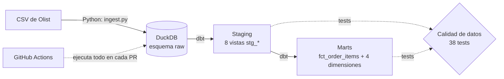

# ecommerce-elt-dbt-duckdb


End-to-end ELT pipeline: Python ingestion, DuckDB storage and dbt transformations (dimensional model and data quality tests) on the Olist e-commerce dataset.

> **Estado:** pipeline funcional y automatizado con GitHub Actions. Dashboard pendiente.

## Objetivo

Construir de punta a punta un flujo de datos como el de un entorno real: cargar datos crudos, ordenarlos por capas, modelarlos de forma dimensional y validar su calidad, para responder preguntas de negocio de un e-commerce:

- ¿Cuánto se vende por mes y por categoría de producto?
- ¿Qué vendedores rinden mejor y cuáles entregan tarde?
- ¿Cuánto tarda la entrega frente a la fecha estimada?

## Arquitectura



| Capa | Contenido | Materialización |
|---|---|---|
| **raw** | Los 9 CSV cargados tal cual | Tablas |
| **staging** | Una vista por tabla cruda: renombrado de columnas y conversión de tipos | Vistas |
| **marts** | Modelo en estrella listo para análisis | Tablas |

### Modelo dimensional

- **Hecho:** `fct_order_items` (una fila por ítem vendido), con `total_item_value`, `delivery_days` e `is_late`.
- **Dimensiones:** `dim_customers`, `dim_sellers`, `dim_products` (con categoría traducida al inglés) y `dim_date`.

## Stack

- **Python** para la ingesta
- **DuckDB** como almacén analítico local
- **dbt-core** (adaptador `dbt-duckdb`) para transformaciones y tests
- **GitHub Actions** para ejecutar el pipeline en cada Pull Request
- **Git / GitHub** para control de versiones

## Dataset

[Brazilian E-Commerce Public Dataset by Olist](https://www.kaggle.com/datasets/olistbr/brazilian-ecommerce/data), publicado en Kaggle por Olist.

Licencia del dataset: [CC BY-NC-SA 4.0](https://creativecommons.org/licenses/by-nc-sa/4.0/). Este proyecto se usa con fines educativos y de portafolio, no comerciales. Los datos **no se incluyen en este repositorio**; deben descargarse desde Kaggle.

Los datos originales se transforman en las capas staging y marts de este proyecto (renombrado de columnas, conversión de tipos, uniones y cálculos).

El código de este repositorio se distribuye bajo licencia MIT (ver `LICENSE`). La licencia del dataset aplica únicamente a los datos.

## Estructura del repositorio

```
.
├── .github/workflows/ci.yml   # pipeline automático
├── data/raw/                  # CSV de Olist (no versionado)
├── ingestion/
│   └── ingest.py              # carga los CSV a DuckDB (esquema raw)
├── dbt_project/
│   ├── dbt_project.yml
│   ├── profiles.yml
│   ├── models/
│   │   ├── staging/           # 8 modelos + tests
│   │   └── marts/             # fct_order_items + 4 dimensiones + tests
│   └── tests/                 # test de clave compuesta
├── requirements.txt
└── README.md
```

## Cómo ejecutarlo

**1. Clonar el repositorio y crear el entorno**

```bash
git clone https://github.com/LuisEnrique98/ecommerce-elt-dbt-duckdb.git
cd ecommerce-elt-dbt-duckdb
python -m venv .venv
.venv\Scripts\activate        # Windows
source .venv/bin/activate     # Linux / Mac
pip install -r requirements.txt
```

**2. Descargar el dataset**

Crear la carpeta `data/raw/` (no viene en el repositorio):

```bash
mkdir -p data/raw             # Linux / Mac
mkdir data\raw                # Windows
```

Descargar el ZIP desde Kaggle (enlace de la sección Dataset) y extraer los 9 archivos CSV en `data/raw/`.

**3. Cargar los datos crudos a DuckDB**

Desde la raíz del proyecto:

```bash
python ingestion/ingest.py
```

Crea `olist.duckdb` con el esquema `raw`. El script es idempotente: puede ejecutarse varias veces sin duplicar datos.

**4. Ejecutar las transformaciones y los tests con dbt**

```bash
cd dbt_project
dbt run --profiles-dir .
dbt test --profiles-dir .
```

El pipeline también se ejecuta automáticamente en GitHub Actions en cada Pull Request.

## Decisiones de diseño

- **ELT en lugar de ETL:** los datos se cargan tal cual al esquema `raw` y la transformación ocurre dentro del almacén con dbt, lo que deja trazable cada paso.
- **Capas separadas:** `raw` queda intacto; `staging` solo ordena; la lógica de negocio vive en `marts`.
- **Granularidad a nivel de ítem:** `fct_order_items` tiene una fila por ítem vendido, lo que permite analizar por producto, categoría y vendedor.
- **Dos identificadores de cliente:** en Olist cada pedido genera un `customer_id` nuevo y `customer_unique_id` identifica a la persona. `dim_customers` conserva ambos para poder identificar clientes recurrentes.
- **Categorías sin traducción:** `dim_products` usa `coalesce` para conservar el nombre original cuando una categoría no tiene traducción al inglés.
- **DuckDB:** no requiere servidor ni credenciales, consume poca memoria y permite reproducir el proyecto en cualquier equipo.
- **Ingesta idempotente:** `CREATE OR REPLACE TABLE` permite relanzar la carga sin efectos secundarios.

## Calidad de datos

38 tests en dbt: unicidad, no nulos, integridad referencial entre tablas, valores aceptados y un test de clave compuesta sobre `order_id` + `order_item_id`.

**Hallazgo:** 789 valores de `review_id` aparecen repetidos en el dataset original. El test está configurado como advertencia (`warn`) en staging, que refleja los datos tal como llegan. Las reseñas no forman parte del modelo dimensional actual.

## Roadmap

- [x] Entorno y estructura del repositorio
- [x] Ingesta de los 9 CSV a DuckDB
- [x] Capa staging en dbt (8 modelos)
- [x] Modelo dimensional (marts)
- [x] Tests de calidad de datos (38 tests)
- [x] Automatización con GitHub Actions
- [x] Diagrama de arquitectura
- [ ] Dashboard

## Autor

**Luis Enrique Allcca Alarcón** — Data Analyst | Data Engineering  
[LinkedIn](https://www.linkedin.com/in/luis-enrique-allcca-alarcon) · [GitHub](https://github.com/LuisEnrique98)

## Licencia

Código bajo licencia [MIT](LICENSE). Dataset bajo [CC BY-NC-SA 4.0](https://creativecommons.org/licenses/by-nc-sa/4.0/).
